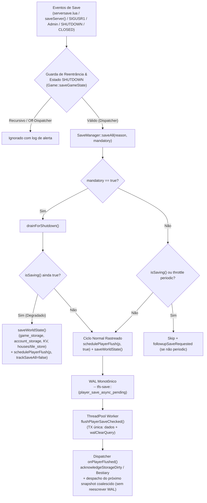

# Auditoria Profunda do Sistema de Save e Persistência — `forgottenserver-downgrade-1.8-8.60`

- **Data da auditoria:** 2026-11-23
- **Repositório:** `Mateuzkl/forgottenserver-downgrade-1.8-8.60`
- **Commit base (`main`):** `7b06effcd39dd5a77199780c79efee1dfb679df9`
- **Branch de trabalho:** `audit/save-system-fix`
- **Ambiente de verificação:** Ubuntu/WSL2 (Linux `6.18.33.2-microsoft-standard-WSL2`, GCC 13.3.0, C++23 com `-Wall -Wextra -Wnon-virtual-dtor -pedantic -Werror`, Ninja, Lua 5.5.0, MariaDB descartável isolado via socket Unix `tools/test-disposable-mariadb.sh`)

---

## 1. Resumo Executivo

Foi conduzida auditoria completa do pipeline de persistência do servidor (TFS 1.8 / protocolo Tibia 8.60), abrangendo `SaveManager`, WAL (`player_save_async_pending`), `IOLoginData`, `IOMapSerialize`, `Game`, `Player`, `House`, `BedItem`, `Mailbox`, `Market`, `KVStore`, `Stash`, `Signals`, `ProtocolAdmin`, `otserv.cpp`, `gdb_config`, `start.sh` e scripts Lua de server save, casas e supply stash.

Foram identificados e corrigidos **14 bugs comprovados** de perda de dados, rollback, duplicação de itens, falha silenciosa de persistência e risco de corrupção em crash/shutdown. Todas as melhorias anteriores do PR `#343` (quarentena, entrega atômica do Market, proteção contra double-save em `serversave.lua`, recovery controlado) foram preservadas.

---

## 2. Mapa do Fluxo de Persistência (Antes vs. Depois)

### Fluxo Principal de Save

### Principais Diferenças (Antes vs. Depois)

| Fluxo | Antes | Depois |
| --- | --- | --- |
| `SaveManager::saveAll(..., mandatory=true)` quando ciclo anterior ainda está ativo/preso | Retornava cedo sem salvar `game_storage`, `account_storage`, `KVStore` nem `houses`/`tile_store`; ou se `drainForShutdown()` retornasse `true` com `isSaving() == true`, caía em `"Save already in progress, skipping."` | Sempre executa `drainForShutdown()`. Se `isSaving()` persistir, executa `saveWorldState()` sincronamente no dispatcher e enfileira o último snapshot de cada jogador vivo na WAL sem corromper `pendingSaveFlushes` |
| WAL `player_save_async_pending` | Header usava apenas `-- tfs-save:<sha1>` (vulnerável a colisão ABA `S1 -> S2 -> S1`); snapshots coalescidos gravavam WAL **duas vezes** (`schedulePlayerFlush` + `dispatchPlayerFlush`) | Header monotônico `-- tfs-save:<gen>:<sha1>` elimina colisão ABA; `PendingPlayerFlush::walPersisted` evita segunda gravação redundante da WAL no despacho |
| `savePlayerSync()` para `Player` offline (`isOffline() == true`) com flush em voo | Enfileirava o `tmpPlayer` carregado do DB desatualizado em `pendingFlushes`, sobrescrevendo o save de logout do jogador e causando rollback + dupe de parcel/itens | Rejeita `savePlayerSync()` offline sem tocar em `pendingFlushes` ou WAL; `Mailbox::sendItem()`, `House::transferToDepot()` e `Houses::payHouses()` verificam a barreira antes de mutar itens |
| `Game::saveAccountStorageValues()` | Usava `break` ao encontrar conta com mapa vazio após `DELETE FROM account_storage`, apagando storages de todas as contas seguintes | Corrigido para `continue` |
| `IOLoginData::savePlayerQueries()` (Depot) | Checava `needsSave()` apenas em `depotLockerMap`, ignorando `depotChests` modificados diretamente | Checa tanto `depotLockerMap` quanto `depotChests` |
| `IOLoginData::savePlayerDailyRewardStorages()` | Escrevia direto em `player_storage` e limpava dirty flags mesmo com worker assíncrono em voo | Bloqueia se em quarentena e roteia via `g_saveManager.savePlayer(player)` se houver flush pendente |
| `House::setOwner()` / `transferToDepot()` / `payHouses()` / `!sellhouse` | Alterava dono no DB antes de transferir itens; ignorava falha de `transferToDepot()`; não atualizava `tile_store`; `payHouses` carregava cópia offline mesmo de jogador online e mutava casa antes do commit; `!sellhouse` falho já havia entregue o ouro ao vendedor e deixava o documento virtual na mochila | Verifica barreira de persistência e transfere/salva itens **antes** de `updateOwnerInDatabase`; persiste `IOMapSerialize::saveHouse(this)`; `payHouses` atua direto no jogador online ou exige commit offline antes de atualizar a casa; `playerAcceptTrade` executa `HouseTransferItem::tryExecuteTransfer` antes de mover o pagamento e sempre remove o documento virtual |
| `IOMapSerialize::saveHouseItems()` / `saveHouseInfo()` | Montava um único `INSERT` sem limite de `max_allowed_packet` | Usa `DBInsert` com chunking automático seguro por `max_allowed_packet` |
| `gdb_config` e `otserv.cpp::saveServer()` | Chamava `call (void)saveServer()` dentro de processo crashado (thread arbitrária, heap/mutex/MySQL potencialmente corrompidos) | Desabilitado em `gdb_config` (preserva backtrace completo + backup pós-crash no `start.sh` + recuperação via WAL no restart); `saveServer()` em `otserv.cpp` recusa execução fora do dispatcher ou durante shutdown/save ativo |
| `ProtocolAdmin` shutdown / `SIGUSR1` / `saveServer()` Lua | `CMD_SHUTDOWN_SERVER` e `CMD_SHUTDOWN_SCHEDULED` chamavam `g_game.shutdown()` direto (pulando kicks/saves); `SIGUSR1` e `saveServer()` não guardavam contra `GAME_STATE_SHUTDOWN` ou reentrância | `ProtocolAdmin` usa `g_game.setGameState(GAME_STATE_SHUTDOWN)`; `Game::saveGameState()`, `SIGUSR1`, `luaSaveServer()` e `CMD_SAVE_SERVER` possuem guarda contra reentrância e pós-shutdown |

---

## 3. Problemas Comprovados e Correções Aplicadas

### 3.1. Críticos (Perda de Dados, Rollback e Duplicação de Itens)

1. **`SaveManager::savePlayerSync()` enfileirava cópia offline desatualizada na WAL de um flush em voo — Dupe de Parcel + Rollback**
   - **Arquivos:** `src/save_manager.cpp`, `src/mailbox.cpp`
   - **Causa raiz:** Quando `flushInFlight.contains(guid)` era verdadeiro (ex.: jogador acabou de deslogar e o worker ainda gravava o snapshot final), qualquer operação offline (`Mailbox::sendItem`, `House::transferToDepot`, `Houses::payHouses`) que carregasse um `Player tmpPlayer(nullptr)` do banco lia dados antigos e chamava `savePlayerSync(&tmpPlayer)`. `savePlayerSync` chamava incondicionalmente `schedulePlayerFlush(&tmpPlayer)`, sobrescrevendo o WAL com estado antigo + item enviado e retornando `false` — fazendo o remetente receber o item de volta (rollback local) enquanto o worker aplicava o snapshot antigo com o item no destinatário (**dupe + rollback**).
   - **Correção:** `savePlayerSync()` só encaminha para `schedulePlayerFlush()` quando `!player->isOffline()`; `Mailbox::sendItem()` verifica `hasPendingPlayerSave(guid)` e `hasFailedRecovery(guid)` antes de mover/transformar o item.

2. **`Game::saveAccountStorageValues()` apagava `account_storage` de contas subsequentes**
   - **Arquivo:** `src/game.cpp`
   - **Causa raiz:** Após `DELETE FROM account_storage`, o loop sobre `g_game.accountStorageMap` fazia `if (accountIt.second.empty()) { break; }` em vez de `continue;`, abandonando o salvamento de todas as contas iteradas após qualquer conta cujas storages foram removidas.
   - **Correção:** Alterado `break;` para `continue;`. Adicionalmente, `Game::saveGameStorageValues()` passou a agrupar os inserts em um único `DBInsert` fora do loop.

3. **`SaveManager::saveAll()` em modo obrigatório (`mandatory=true`) podia pular salvamento de storages globais, storages de conta, KV e casas/mapa — ou pular o save inteiro**
   - **Arquivo:** `src/save_manager.cpp`, `src/save_manager.h`
   - **Causa raiz:** (a) No caminho `if (mandatory && !drainForShutdown() && isSaving())`, o método retornava cedo após enfileirar players sem chamar `saveGameStorageValues()`, `saveAccountStorageValues()`, `KVStore::saveAll()` ou `IOMapSerialize::saveHouseInfo()/saveHouseItems()`, além de passar `trackSaveAll=true` no ciclo preso; (b) quando `drainForShutdown()` retornava `true` mas `isSaving()` ainda estava ativo, caía em `if (isSaving())` e pulava todo o save obrigatório (bug adicional comprovado durante a execução de `test_save_system_db`).
   - **Correção:** Extraído `SaveManager::saveWorldState()`. Em `saveAll(..., true)`, sempre executa `drainForShutdown()`; se `isSaving()` permanecer ativo, executa `saveWorldState()` sincronamente no dispatcher e enfileira cada jogador vivo com `trackSaveAll=false`. Também adicionadas guardas de thread do dispatcher em `saveAll()` e `drainForShutdown()`.

4. **`House::setOwner()`, `House::transferToDepot()` e `Houses::payHouses()` — Perda permanente de itens da casa, sobrescrita de jogador online e dupe de itens de casa em crash**
   - **Arquivos:** `src/house.h`, `src/house.cpp`
   - **Causa raiz:**
     - `House::transferToDepot()` carregava `tmpPlayer` offline sem verificar `hasPendingPlayerSave`/`hasFailedRecovery`, movia todos os itens dos tiles da casa para o inbox temporário na stack e só então chamava `savePlayerSync(&tmpPlayer)` — em caso de falha, todos os itens eram destruídos com `tmpPlayer`.
     - `House::setOwner()` atualizava `houses.owner` no MySQL **antes** de `transferToDepot()`, ignorava o retorno booleano de `transferToDepot()` e nunca chamava `IOMapSerialize::saveHouse(this)` (deixando itens duplicados em `tile_store` em caso de crash).
     - `Houses::payHouses()` (também acionável em runtime) carregava cópia offline mesmo se o dono estivesse online, sobrescrevendo o estado ao vivo ou perdendo itens transferidos no próximo save do jogador, e mutava `paidUntil`/`warnings` antes de confirmar `savePlayerSync()`.
   - **Correção:** `House::transferToDepotChecked()` valida barreira de persistência antes de carregar/mover itens e diferencia dono ausente no DB de erro transitório/barreira; `House::setOwner()` transfere e persiste itens **antes** de `updateOwnerInDatabase()`, aborta em falha real e chama `IOMapSerialize::saveHouse(this)` após limpar os tiles; `Houses::payHouses()` opera diretamente sobre o jogador online quando conectado, respeita a barreira offline, só remove dono inexistente quando `db.getLastErrno() == 0` e só atualiza `paidUntil`/`warnings` após commit confirmado.

5. **`Game::playerAcceptTrade()` + `HouseTransferItem::onTradeEvent()` — Perda de pagamento em falha de `!sellhouse` e segundo `internalMoveItem` não verificado**
   - **Arquivos:** `src/game.cpp`, `src/house.h`, `src/house.cpp`
   - **Causa raiz:** Em `!sellhouse`, o ouro do comprador era movido ao vendedor antes de `HouseTransferItem::onTradeEvent()` executar `House::executeTransfer()`. Se a transferência falhasse (ex.: cama ocupada com save pendente ou erro de DB), o vendedor ficava com a casa **e** o ouro, e o documento virtual permanecia no inventário do comprador (retorno antecipado antes de `internalRemoveItem(this, 1)`). Além disso, em trades comuns, o retorno do segundo `internalMoveItem` era ignorado.
   - **Correção:** `HouseTransferItem::tryExecuteTransfer()` é executado antes da movimentação dos itens de pagamento em `playerAcceptTrade()`; em falha, o pagamento não é movido e `onTradeEvent(ON_TRADE_TRANSFER)` sempre remove o documento virtual. O retorno do segundo `internalMoveItem` é verificado com rollback do primeiro movimento em caso de falha.

6. **`IOLoginData::savePlayerQueries()` ignorava `DepotChest::needsSave()`**
   - **Arquivo:** `src/iologindata.cpp`
   - **Causa raiz:** Apenas `player->depotLockerMap` era verificado para `needsSave()`. Modificações diretas via `player->getDepotChest(depotId, true)` (scripts Lua, Market, Supply Stash) sem abrir o locker deixavam `needsSave = false`, omitindo `DELETE/INSERT` em `player_depotitems` (causando dupe ao remover ou perda ao adicionar).
   - **Correção:** Verificação estendida para `player->depotChests` quando `depotLockerMap` não sinaliza alteração.

7. **`IOLoginData::savePlayerDailyRewardStorages()` contornava a fila ordenada do `SaveManager`**
   - **Arquivo:** `src/iologindata.cpp`
   - **Causa raiz:** Gravava diretamente em `player_storage` e limpava dirty flags mesmo quando havia um worker assíncrono em execução com snapshot antigo — permitindo que o worker antigo sobrescrevesse as storages de recompensa diária sem nova marcação dirty.
   - **Correção:** Recusa se `hasFailedRecovery(playerId)` e roteia via `g_saveManager.savePlayer(player)` quando `hasPendingPlayerSave(playerId)` é verdadeiro.

8. **`ProtocolAdmin` `CMD_SHUTDOWN_SERVER` / `CMD_SHUTDOWN_SCHEDULED` pulavam o fluxo de shutdown e salvamento**
   - **Arquivo:** `src/protocoladmin.cpp`
   - **Causa raiz:** Chamavam `g_game.shutdown()` diretamente em vez de `g_game.setGameState(GAME_STATE_SHUTDOWN)`, pulando `GlobalEvents::save()`, kick/save de jogadores, `saveGameState()` e `drainForShutdown()`.
   - **Correção:** Alterado para `g_game.setGameState(GAME_STATE_SHUTDOWN)`, e `CMD_SAVE_SERVER` protegido contra reentrância/pós-shutdown com chamada a `g_globalEvents->save()`.

### 3.2. Altos e Médios (WAL, Crash-Safety, Pacote SQL, KV, Reentrância e Scripts Lua)

9. **Colisão ABA na WAL e gravação duplicada de WAL em snapshots coalescidos**
   - **Arquivos:** `src/save_manager.h`, `src/save_manager.cpp`
   - **Correção:** Adicionado contador monotônico `nextWalGeneration` no header `-- tfs-save:<gen>:<sha1>` (retrocompatível com `recoverPendingFlushes()`) e flag `PendingPlayerFlush::walPersisted` para não regravar a WAL em `dispatchPlayerFlush()` quando já persistida por `schedulePlayerFlush()`.

10. **Save emergencial inseguro dentro de processo crashado via GDB**
    - **Arquivos:** `gdb_config`, `src/otserv.cpp`
    - **Correção:** Desabilitado `call (void)saveServer()` no `gdb_config`, preservando o backtrace completo de todas as threads e o exit code de crash para que `start.sh` faça backup do banco e reinicie com recuperação via WAL (`SaveManager::recoverPendingFlushes()`). `extern "C" void saveServer()` em `src/otserv.cpp` foi mantido por compatibilidade, porém bloqueado fora da thread do dispatcher e durante shutdown/save em andamento.

11. **`IOMapSerialize::saveHouseItems()` e `saveHouseInfo()` sem divisão por `max_allowed_packet`**
    - **Arquivo:** `src/iomapserialize.cpp`
    - **Correção:** Migrados para `DBInsert` (com `upsert` em `saveHouseInfo()`), prevenindo falha total de salvamento de casas em mapas populosos.

12. **Reentrância em `Game::saveGameState()`, `SIGUSR1` e `saveServer()` Lua**
    - **Arquivos:** `src/game.h`, `src/game.cpp`, `src/signals.cpp`, `src/luascript.cpp`
    - **Correção:** Adicionada guarda RAII `saveGameStateInProgress` e validação de dispatcher em `Game::saveGameState()`; `sigusr1Handler()` e `luaSaveServer()` ignoram chamadas durante `GAME_STATE_SHUTDOWN` ou save já em andamento.

13. **`KVStore::prepareSave()` ignorava falha de `DBInsert::addRow()` e `KVStore::flush()` não limpava `lruQueue_`**
    - **Arquivo:** `src/kv/kv.cpp`
    - **Correção:** `prepareSave()` propaga o retorno booleano de `update.addRow(...)`; `flush()` limpa `lruQueue_` junto com `store_`.

14. **Scripts Lua de Casa e Supply Stash + vazamento de pilha em `luaPlayerDrainAsyncSave`**
    - **Arquivos:** `data/scripts/talkactions/player/house_system/buyhouse.lua`, `leavehouse.lua`, `buygh.lua`, `data/scripts/network/supply_stash/supplystash.lua`, `src/luaplayer.cpp`
    - **Correção:**
      - `buyhouse.lua` e `buygh.lua` verificam o retorno de `house:setOwnerGuid(...)`, devolvem o pagamento em caso de falha e chamam `player:saveAsync()` em sucesso.
      - `leavehouse.lua` verifica `house:setOwnerGuid(...)` antes de remover o recibo de guildhall ou limpar storage.
      - `supplystash.lua` chama `player:saveAsync()` imediatamente após `stowAll()` e `withdraw()`, reduzindo a janela de dessincronização entre `player_supplystash` (commit imediato) e inventário/depot em RAM.
      - `src/luaplayer.cpp` adiciona `lua_pop(luaState, 1)` no caminho de erro de `luaPlayerDrainAsyncSave`.

---

## 4. Testes Executados e Evidências Reais

Nenhuma execução destrutiva foi feita contra o banco de produção (`860`). Todos os testes de banco rodaram contra um servidor MariaDB descartável e isolado criado por `tools/test-disposable-mariadb.sh` em `/tmp/tfs-test-db.*` e destruído automaticamente ao final.

| Verificação | Resultado | Detalhes Reais |
| --- | --- | --- |
| `cmake -P tools/check-shared-get-escapes.cmake` | **PASS** | Nenhum escape inseguro de `shared_ptr::get()` em lambdas/async |
| `cmake -P tools/check-source-list-parity.cmake` | **PASS** | `src/CMakeLists.txt` e `vc18/theforgottenserver.vcxproj` sincronizados |
| `cmake -P tools/check-manual-delete.cmake` | **PASS** | Nenhuma expressão manual de `delete` |
| `luac -p` (Lua 5.5.0) nos 6 scripts Lua alterados/relevantes | **PASS** | `serversave.lua`, `buyhouse.lua`, `leavehouse.lua`, `buygh.lua`, `supplystash.lua`, `market_save_regressions.lua` |
| `lua .github/tests/market_save_regressions.lua` | **PASS** | Valida proteção de save único em `open`/`close`/`shutdown`, entrega Market, inbox legado e limites de saldo |
| Compilação Linux Release C++23 (GCC 13.3.0, `-Werror`, Ninja) | **PASS** | Alvo `tfs` + todos os executáveis de teste compilados com **0 erros e 0 warnings** |
| **Suíte CTest completa** (`tools/test-disposable-mariadb.sh`) | **PASS (65/65)** | **100% (65 de 65 testes)** aprovados em `18.55s`, incluindo `test_save_system_db` (`0.53s`), `test_market_delivery_db` (`1.51s`), `test_account_manager_db`, `test_inbox_db_roundtrip`, `test_item_lifetime`, `test_house_persistence`, `test_house_map_beds`, `test_database_task_rejection`, `test_storage_maps` |

### Cobertura do Novo Teste `src/tests/test_save_system_db.cpp`

Executado contra MariaDB real descartável (`test_save_system_db` — **PASSED**):
1. Geração monotônica de WAL impedindo colisão ABA (`S1 -> S2 -> S3` idêntico a `S1`).
2. 100 saves consecutivos rápidos em burst com coalescing, preservação de saldo final (`10100`), container aninhado + item stackable (`75` gold coins) e limpeza total da WAL.
3. Rejeição de `savePlayerSync()` para cópia offline durante flush assíncrono em voo sem enfileirar estado antigo nem corromper o saldo real (`55555`).
4. Persistência de `DepotChest::needsSave()` (adição e remoção) sem abertura prévia de `DepotLocker`.
5. Guarda de reentrância em `Game::saveGameState()`.
6. Roteamento ordenado de `IOLoginData::savePlayerDailyRewardStorages()` quando há flush assíncrono em voo.
7. `Game::saveAccountStorageValues()` com conta vazia antes de contas com dados + caminho obrigatório degradado de `SaveManager::saveAll("shutdown", true)` preservando `game_storage`, `account_storage` e `kv_store`.
8. Bloqueio de `House::setOwner(0, true)` quando o dono offline possui flush assíncrono em voo (sem alterar `houses.owner` no DB).
9. Barreira de login `drainPlayerFlushAsync()` aguardando o flush pendente + replay idempotente de WAL via `SaveManager::recoverPendingFlushes()`.

### O Que Não Foi Executado Neste Ambiente

- **ASan / TSan / Valgrind:** Não executados localmente nesta rodada (build rodou em `Release` com `-Werror` no WSL). Recomendado rodar o workflow de CI com ASan/TSan antes do merge final do Draft PR.
- **Compilação Windows MSVC (`vc18`) em disco local:** Não reconstruída para preservar espaço em `C:` (verificação de paridade de fontes `check-source-list-parity.cmake` passou; CI Windows validará MSVC).
- **Teste de carga ao vivo com 100+ jogadores reais / `/dupe start` in-game:** Requer servidor ativo em ambiente de homologação.

---

## 5. Riscos Residuais Conhecidos (Fora de Mudanças Destrutivas)

1. **Supply Stash (`supplystash.lua`):** Embora `player:saveAsync()` agora registre imediatamente o snapshot do inventário/depot na WAL após `stowAll()`/`withdraw()`, a operação SQL em `player_supplystash` e a gravação da WAL ainda ocorrem em transações separadas (uma queda abrupta de energia nos milissegundos entre ambas ainda possui janela residual). Eliminação total exigiria migrar `stowAll`/`withdraw` para uma ponte nativa usando `SaveManager::savePlayersAtomic()`.
2. **Trade comum entre dois jogadores (`Game::playerAcceptTrade`):** Como no TFS padrão, a troca entre dois jogadores altera ambos em RAM e persiste no próximo save (ou logout). Em caso de crash imediato onde apenas um jogador deslogou/salvou antes do outro, existe janela clássica de dessincronização entre dois personagens; mitigação completa exigiria `savePlayersAtomic({player, tradePartner})` no fechamento de trades de alto valor (avaliar impacto de latência antes de ativar).
3. **Falha de banco durante `House::transferToDepot()` após movimentação parcial de tiles:** Embora a barreira de persistência e erros de carga agora abortem **antes** de mover qualquer item, uma queda súbita do MySQL *exatamente* durante `savePlayerSync(&tmpPlayer)` após esvaziar os tiles ainda depende da recuperação/quarentena do `SaveManager` (`data/save-quarantine/<guid>.sql`).
4. **Watchdog de 60s (`otserv.cpp`):** Mantido em `60s` (`drainForShutdown()` usa timeout de `30s`), garantindo que o servidor não trave indefinidamente no shutdown sem truncar o drain normal de 30s.

---

## 6. Procedimento Seguro de Atualização em Produção (Sem Perda de Dados)

1. **Backup completo pré-deploy:** Faça `mysqldump` do banco de produção e copie o diretório `data/save-quarantine/` (se existir).
2. **Parada controlada:** Encerre o servidor atual de forma limpa (`SIGTERM` ou `GAME_STATE_SHUTDOWN`), aguardando `>> Shutdown complete.` e verificando que `SELECT COUNT(*) FROM player_save_async_pending;` esteja em `0`.
3. **Nenhuma migration destrutiva necessária:** O formato de WAL `-- tfs-save:<gen>:<sha1>` é 100% compatível com a tabela `player_save_async_pending` existente e com `SaveManager::recoverPendingFlushes()`.
4. **Deploy conjunto:** Atualize o binário compilado, `gdb_config` e os scripts Lua modificados (`buyhouse.lua`, `leavehouse.lua`, `buygh.lua`, `supplystash.lua`) juntos antes de subir o servidor.
5. **Validação pós-subida:** Confirme nos logs que `recoverPendingFlushes()` não reportou GUIDs em quarentena e valide com um personagem de teste: logout, `/dupe start`, `!buyhouse`/`!leavehouse`, Supply Stash e `saveServer()`.
